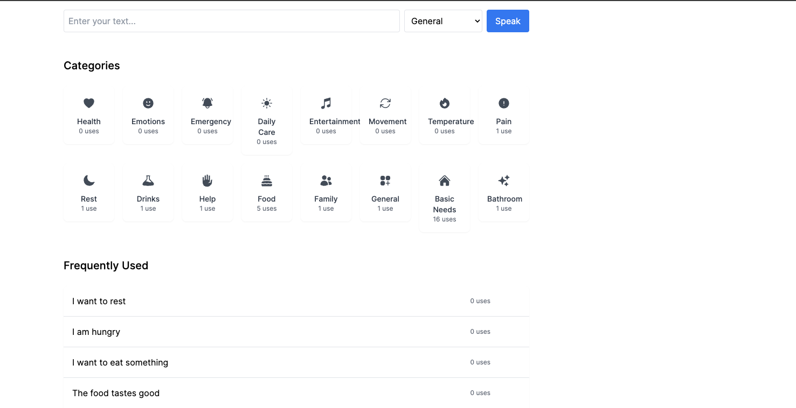
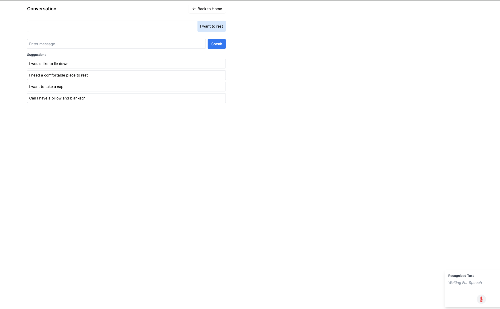

# Listen2Me

Listen2Me is an assistive communication application designed for people who are temporarily or permanently unable to speak, such as patients after tracheostomy or those with other conditions affecting speech capabilities.

## Features

- Text-to-Speech functionality
- Sentence categorization and management
- Quick access to frequently used sentences
- Multilingual interface (English/German)
- Three-step onboarding for language, interaction mode, and device checks
- Conversation mode with AI-powered response suggestions
- Optional low-latency Realtime conversation adapter with a local fallback
- Responsive design for desktop and mobile devices

## Speech Output

The application supports two types of speech output:

### 1. Browser Speech (Default)
- Uses the built-in Web Speech API
- No additional configuration required
- Available in all modern browsers
- Quality depends on browser and installed voices
- Currently used for every spoken output, including when provider credentials are stored

### 2. Personal voice provider (planned adapter)
- The settings retain the provider and voice fields needed for a future
  server-side personal-voice adapter.
- The current demo deliberately uses browser speech only. Provider keys are
  never sent to the browser and are encrypted in the database.
- Context suggestions work without a configured AI provider by using three
  built-in, localized fallback suggestions.




> **Note**: This project is currently in early development and is being developed in our free time. We aim to create a free, open-source tool for people who need this type of assistance. We warmly welcome anyone who would like to contribute to this meaningful project!

## Quick Start with Docker

### Prerequisites
- Docker Desktop installed ([Download here](https://www.docker.com/products/docker-desktop/))
- Git installed ([Download here](https://git-scm.com/downloads))

### Installation Steps

1. Clone the repository:
   ```bash
   git clone https://github.com/stefan-kp/listen2me.git
   cd listen2me
   ```

2. Start the application:
   ```bash
   docker compose up
   ```

3. Access the application:
   - Open your browser and go to http://localhost:80
   - Create a new account
   - API keys are optional for the current demo.
   - An AI provider key enables generated conversation suggestions; without it,
     safe built-in suggestions remain available.

The first sign-in opens a short onboarding flow. The regular conversation mode
works without external services. When an OpenAI key is stored in Settings, the
conversation screen additionally offers an experimental, user-initiated
Realtime mode; if it cannot connect, the normal flow remains available.

That's it! The application will automatically:
- Set up the database
- Install all dependencies
- Start the development server
- Initialize required data

> **Note**: The application uses Docker and PostgreSQL. The database configuration 
> is handled automatically through environment variables in docker-compose.yml - 
> no manual database configuration is needed.

For deployments, keep `SECRET_KEY_BASE` stable. Provider-key encryption is
derived from it unless the three dedicated variables
`ACTIVE_RECORD_ENCRYPTION_PRIMARY_KEY`,
`ACTIVE_RECORD_ENCRYPTION_DETERMINISTIC_KEY`, and
`ACTIVE_RECORD_ENCRYPTION_KEY_DERIVATION_SALT` are supplied. Dedicated,
secret-managed values are recommended for production.

### Stopping the Application
```bash
docker compose down
```
