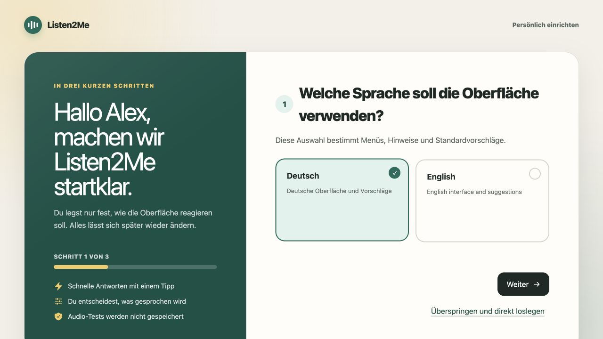
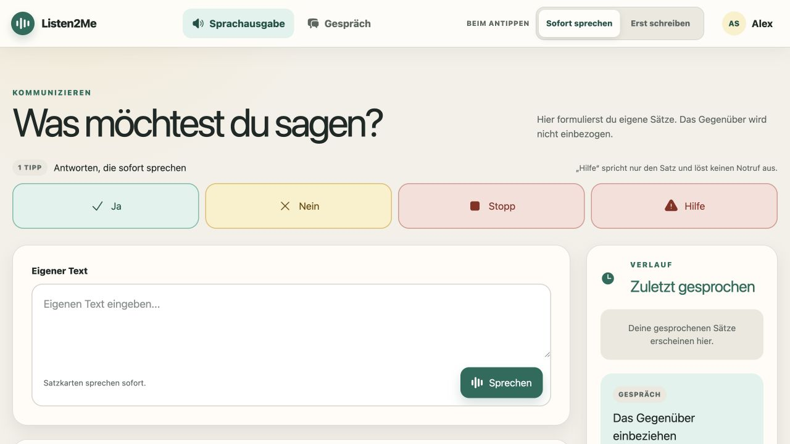
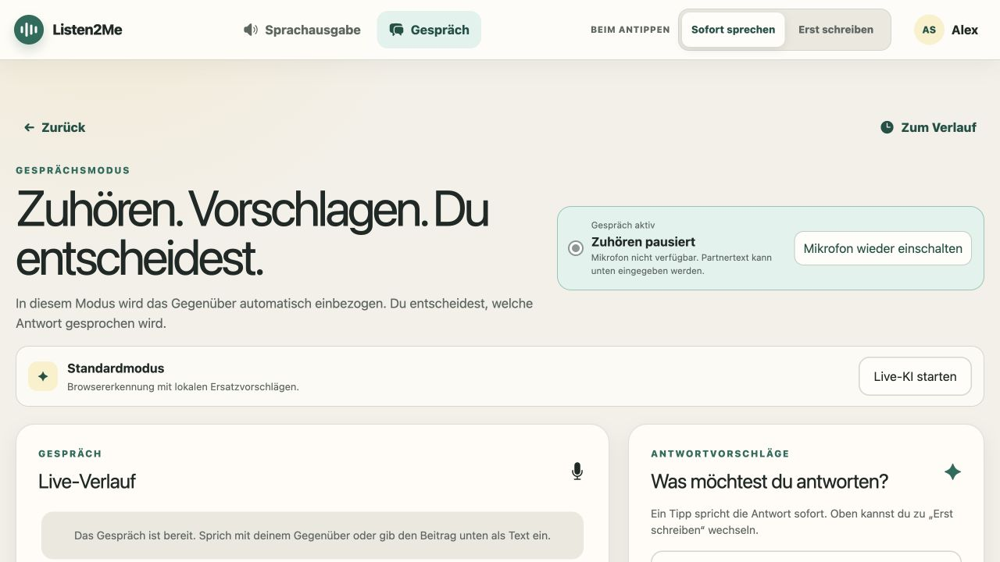

# Listen2Me

Listen2Me is an assistive communication application designed for people who are temporarily or permanently unable to speak, such as patients after tracheostomy or those with other conditions affecting speech capabilities.

## Features

- Text-to-Speech functionality
- Sentence categorization and management
- Quick access to frequently used sentences
- Multilingual interface (English/German)
- Three-step onboarding for language, interaction mode, and device checks
- Conversation mode with AI-powered response suggestions
- Optional low-latency Realtime conversation adapter with a local fallback
- Responsive design for desktop and mobile devices

## AI suggestions

Generated reply suggestions use an OpenAI-compatible LiteLLM proxy on the
server. Provider credentials and routing stay in LiteLLM; the browser receives
only the three short suggestions. Listen2Me supports two stable proxy aliases:

- `fast` for the lowest practical interaction latency (default)
- `cheap` for a lower-cost model

Set `LITELLM_HOST` (with or without `/v1`) and a dedicated
`LITELLM_SECRET`. The optional `LITELLM_FAST_MODEL` and
`LITELLM_CHEAP_MODEL` variables can map the two profiles to different proxy
aliases. The app bounds the request to three through five seconds (five by default),
validates the response, and immediately falls back to three localized standard
answers if the proxy is missing, unavailable, or returns malformed data.
Suggestions are never spoken merely because they were generated; the person
using Listen2Me always chooses the next action.

For the proxy, use a virtual application key restricted to these model aliases
and set budgets and rate limits centrally. Do not put provider keys into the
Listen2Me browser or source tree.

When LiteLLM runs directly on the Docker host, use
`LITELLM_HOST=http://host.docker.internal:4000` as shown in `.env.sample`.
When it runs as another Compose service, place both services on the same network
and use that service name instead, for example `http://litellm:4000`.

## Speech Output

Every sentence is spoken only after an explicit user action. Generated
suggestions are never auto-spoken. Speech output follows a resilient server and
browser chain:

1. The selected server-side provider streams raw 24 kHz PCM to the browser.
2. If the provider fails before audio starts, the built-in browser voice takes
   over immediately.
3. If a stream breaks after audio has started, Listen2Me stops and asks for a
   retry rather than speaking the sentence twice.

OpenAI is the default with `gpt-4o-mini-tts` and the `marin` voice. Configure
`OPENAI_API_KEY`; optionally override `OPENAI_TTS_MODEL`, `OPENAI_TTS_VOICE`,
or use an eligible custom voice through `OPENAI_CUSTOM_VOICE_ID`.

Cartesia and ElevenLabs are optional comparison providers. Their keys remain on
the Rails server, and a German/public voice is discovered when no explicit
`CARTESIA_VOICE_ID` or `ELEVENLABS_VOICE_ID` is configured. They are never
selected automatically after an OpenAI error. The shared default daily limits
are 500 Cartesia characters and 300 ElevenLabs characters across the whole
demo; repeated identical phrases are served from a bounded, process-memory
cache. A limit of `0` disables that provider. Adjust
`CARTESIA_DAILY_CHARACTER_LIMIT` and `ELEVENLABS_DAILY_CHARACTER_LIMIT` only
deliberately.

Browser speech remains available without any external service. Provider keys
are never rendered in HTML or returned to JavaScript. The settings page exposes
only availability and a human-readable provider choice. The UI discloses that
cloud speech is AI-generated.

## Google sign-in

Google sign-in is optional. Password registration and sign-in continue to work
when Google is not configured. To enable it, create an OAuth client of type
**Web application** in Google Cloud and set `GOOGLE_CLIENT_ID` and
`GOOGLE_CLIENT_SECRET` on the Rails server.

Register the callback URI exactly, including scheme, host, port, and path:

- Local port 3000:
  `http://localhost:3000/users/auth/google_oauth2/callback`
- Local preview on port 3004:
  `http://127.0.0.1:3004/users/auth/google_oauth2/callback`
- Production:
  `https://your-host.example/users/auth/google_oauth2/callback`

`localhost` and `127.0.0.1` count as different callback hosts. Behind a reverse
proxy, set `APP_ORIGIN` to the public HTTPS origin, without a trailing slash.
When exercising the production container locally over plain HTTP, set
`APP_ORIGIN` to that exact localhost origin and
`ALLOW_INSECURE_LOCAL_HTTP=true`. This exception is deliberately ignored for
non-local hosts.
Listen2Me requests only OpenID, email, and profile identity data and does not
store Google access or refresh tokens. A Google identity is keyed by Google's
stable account ID, not by email address. An existing password account must be
signed in before Google can be linked to it.

## Current interface

### Three-step onboarding



### Speech output



### Conversation mode



> **Note**: This project is currently in early development and is being developed in our free time. We aim to create a free, open-source tool for people who need this type of assistance. We warmly welcome anyone who would like to contribute to this meaningful project!

## Container image

After all CI checks pass, the `Container Image` workflow builds the production
Dockerfile for pull requests, pushes to `main`, and version tags beginning with
`v`. Pull requests are build-only. Main and version-tag builds publish an AMD64
image to `ghcr.io/stefan-kp/listen2me` with `latest`, branch, semantic-version,
short-SHA, and full commit-SHA tags. The full SHA tag supports Kamal deployments
without rebuilding the image. The workflow can also be started manually, with
publishing enabled by default. GitHub's repository token handles publishing; no
separate registry token is needed by the workflow.

For anonymous pulls, make the linked GHCR package public once in its package
settings. Registry tags can be moved; deployments that require technical
immutability should pin the image digest rather than relying on `latest`.

## Quick Start with Docker

### Prerequisites
- Docker Desktop installed ([Download here](https://www.docker.com/products/docker-desktop/))
- Git installed ([Download here](https://git-scm.com/downloads))

### Installation Steps

1. Clone the repository:
   ```bash
   git clone https://github.com/stefan-kp/listen2me.git
   cd listen2me
   ```

2. Start the application:
   ```bash
   docker compose up
   ```

3. Access the application:
   - Open your browser and go to http://localhost:80
   - Create a new account
   - External services are optional for the current demo.
   - A server-side LiteLLM proxy enables generated conversation suggestions;
     without it, safe built-in suggestions remain available.

The first sign-in opens a short onboarding flow. The regular conversation mode
works without external services. If `OPENAI_API_KEY` is configured on the
server, the conversation screen additionally offers user-initiated live
transcription over WebRTC; if it cannot connect, the browser recognizer and
manual text input remain available. The microphone track is enabled only after
the Listen2Me user's spoken answer and is disabled again when the other
person's utterance ends. Realtime never generates or speaks an answer; the
final transcript is stored as a partner message and passed to the same
server-side LiteLLM suggestion flow as manual input. The OpenAI key is not
stored in a user account and is never sent to the browser. Override the
Realtime and transcription models with `OPENAI_REALTIME_MODEL` and
`OPENAI_TRANSCRIPTION_MODEL`. Live transcription sessions end after five
minutes; users can explicitly start another session.

That's it! The application will automatically:
- Set up the database
- Install all dependencies
- Start the development server
- Initialize required data, including an idempotent default-content backfill for
  existing accounts

> **Note**: The application uses Docker and PostgreSQL. The database configuration 
> is handled automatically through environment variables in docker-compose.yml - 
> no manual database configuration is needed.

For deployments, keep `SECRET_KEY_BASE` stable. Provider-key encryption is
derived from it unless the three dedicated variables
`ACTIVE_RECORD_ENCRYPTION_PRIMARY_KEY`,
`ACTIVE_RECORD_ENCRYPTION_DETERMINISTIC_KEY`, and
`ACTIVE_RECORD_ENCRYPTION_KEY_DERIVATION_SALT` are supplied. Dedicated,
secret-managed values are recommended for production.

Production uses one PostgreSQL database for application data, Solid Cache,
Solid Queue, and Solid Cable. Set a single `DATABASE_URL`; `db:prepare` creates
all required tables through the regular migration chain. If upgrading an
already-running installation that used four databases, drain or migrate pending
Solid Queue jobs before switching. Cache entries and transient Cable messages
can normally be discarded, but queued work should not be silently abandoned.

### Stopping the Application
```bash
docker compose down
```
